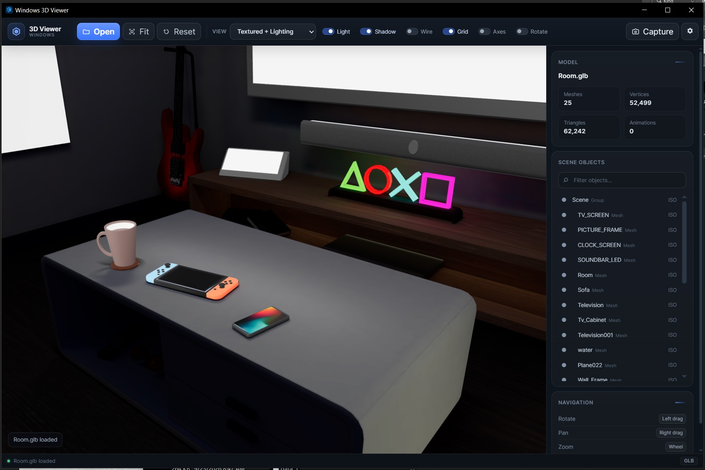

# 3D Viewer for Windows — نمایشگر مدل‌های سه‌بعدی ویندوز

**3D Viewer** is a lightweight desktop **3D model viewer for Windows 10 and Windows 11**. Open GLB, glTF, FBX, OBJ, STL and other 3D files, inspect textures and vertex colors, explore scenes with a fly camera, and adjust the orientation, scale and pivot of static GLB models.

**نمایشگر سه‌بعدی ویندوز** برای باز کردن و مشاهدهٔ فایل‌های GLB، glTF، FBX، OBJ و STL، بررسی تکسچر و رنگ ورتکس، حرکت در صحنه و اصلاح اندازه، چرخش و Pivot مدل‌های ثابت GLB.

[Download for Windows](https://github.com/emadgh/windows-3d-viewer/releases/latest) · [دانلود برای ویندوز](https://github.com/emadgh/windows-3d-viewer/releases/latest) · [Report an issue](https://github.com/emadgh/windows-3d-viewer/issues)



## Download and get started

1. Open the [latest release](https://github.com/emadgh/windows-3d-viewer/releases/latest) and download **[3D-Viewer.exe](https://github.com/emadgh/windows-3d-viewer/releases/latest/download/3D-Viewer.exe)**.
2. Run the executable on **Windows 10 or Windows 11, x64**. The app uses the **Microsoft Edge WebView2 Runtime**, which must be installed.
3. Click **Open**, or drag a model into the viewer. Keep related textures and sidecar files with the model; when using multi-file selection, include the files it needs.
4. Use the **Camera**, **View** and **Scene** menus to navigate and inspect the model.

The application is distributed as a single portable executable. There is no application installer, separate resources folder or `WebView2Loader.dll` to copy. Release downloads also include a SHA-256 checksum file.

## Supported 3D file formats

| Format | Extensions | Common use |
| --- | --- | --- |
| GLB / glTF | `.glb`, `.gltf` | 3D models, materials, textures, scenes and animations |
| Autodesk FBX | `.fbx` | Exported assets, scenes and animations |
| Wavefront OBJ | `.obj`, `.mtl` | Meshes with companion material and texture files |
| STL | `.stl` | Mesh inspection and 3D printing models |
| PLY | `.ply` | Meshes, including models with vertex colors |
| COLLADA | `.dae` | Exported 3D scenes |
| 3MF | `.3mf` | 3D manufacturing models |
| 3D Studio | `.3ds` | Legacy 3D assets |
| USDZ | `.usdz` | Packaged 3D assets |
| VRML | `.wrl`, `.vrml` | VRML models and scenes |

The glTF loader supports **Draco**, **Meshopt** and **KTX2/Basis** decoding. Available materials, animation and appearance depend on the source file and format. Transform editing and saving are available for **GLB** models.

## Inspect textures, vertex colors and lighting

Choose an appearance preset from the **View** menu:

- **Textures only:** view base-color materials and textures without vertex-color shading, baked AO/lightmaps or viewer lighting.
- **Baked lighting:** view textures with vertex colors and authored ambient-occlusion/lightmap data, without adding viewer lighting. Useful for exported levels and assets from older games.
- **Lit materials:** inspect materials with the viewer's environment, key and fill lights. Viewer lighting can also be applied to authored unlit materials.

Vertex colors, baked maps, viewer lighting and viewer shadows have separate controls. You can also inspect **Vertex colors**, **Clay** or **Wireframe** on their own, or add a wireframe overlay to another view. In Vertex colors view, meshes without color data appear gray.

These are display controls: switching views preserves the original materials used when saving a GLB.

## Camera controls

| Action | Control |
| --- | --- |
| Orbit around the scene | Hold left mouse and drag |
| Pan the camera | Hold middle mouse and drag |
| Zoom | Mouse wheel, or Alt + middle mouse drag |
| Fly and look around | Hold right mouse and move the mouse |
| Move while flying | `W` / `S` forward and backward; `A` / `D` left and right |
| Elevation while flying | `E` / `Q` along camera up and down |
| Fit model in view | `F`, or Camera → Fit model |
| Reset camera | Camera → Reset camera |
| Focus an object | Double-click a visible object |

Flight works only while right mouse is held. Movement follows the camera's orientation. Conflicting viewer shortcuts are suspended during flight, and releasing right mouse returns control to orbit navigation.

## GLB transform editing and Reset XForm

For a loaded GLB, enable **Edit** in the Transform panel to move, rotate or scale the model. Choose a center, bottom or object pivot, enter numerical transforms or dimensions, and use the X/Y surface guides for precision alignment.

**Reset XForm / Bake** writes the corrected rotation and scale into static geometry and makes the selected pivot the actual model origin. Rotation resets to zero and scale to one, while the model's visible placement is preserved. The root position locates the selected pivot in the scene.

- **Save** writes changes to the current writable GLB source.
- **Save As** creates another GLB file.
- **Revert to saved** restores unsaved geometry and transforms to the saved baseline.

Baking is limited to static models. Models with animation clips, skins, bones, instances, morph targets, embedded cameras or lights are excluded from Reset XForm.

## More features

- Scene/object tree with visibility, isolation, focus and search.
- Animation clip selection, playback, pause and restart.
- Mesh, vertex, triangle and animation statistics.
- Bounding-box dimensions and a 1.75 m person reference for scale comparison.
- Ground grid, world axes and automatic camera rotation.
- PNG viewport screenshots.
- File associations for opening supported models from Windows Explorer.
- Single-instance and multiple-instance preferences.
- In-app update checks and downloads from GitHub Releases, with SHA-256 verification.

### Open models from Windows Explorer

Use **Settings** to register file associations, then confirm your preferred default app in Windows **Default Apps**. Windows launches the executable with the selected file path:

```text
"3D-Viewer.exe" "%1"
```

For models opened through Explorer, the native host makes related files in the model directory tree available to the viewer, including `.bin`, `.mtl`, image textures, DDS, KTX2, HDR and EXR files. Missing dependencies still need to be supplied with the model.

<div dir="rtl">

## معرفی فارسی — دانلود نمایشگر فایل‌های سه‌بعدی برای ویندوز

**3D Viewer** یک برنامهٔ سبک برای مشاهدهٔ مدل‌ها و صحنه‌های سه‌بعدی در ویندوز ۱۰ و ۱۱ است. برای باز کردن فایل‌های **GLB، glTF، FBX، OBJ و STL** و بررسی ظاهر و ساختار آن‌ها می‌توانید از این برنامه استفاده کنید. فرمت‌های PLY، DAE، 3MF، 3DS، USDZ و VRML نیز پشتیبانی می‌شوند.

### دانلود و اجرا

از [صفحهٔ آخرین نسخه](https://github.com/emadgh/windows-3d-viewer/releases/latest)، فایل **3D-Viewer.exe** را دانلود و اجرا کنید. نسخهٔ منتشرشده برای ویندوز ۶۴ بیتی است و به **Microsoft Edge WebView2 Runtime** نیاز دارد. خود برنامه نصب‌کننده ندارد و به‌صورت یک فایل اجرایی ارائه می‌شود.

برای باز کردن مدل، از دکمهٔ Open یا کشیدن و رها کردن فایل داخل پنجره استفاده کنید. تکسچرها و فایل‌های جانبی مثل MTL و BIN را همراه مدل نگه دارید؛ در انتخاب چندفایلی، وابستگی‌های لازم را هم انتخاب کنید.

### بررسی تکسچر، رنگ ورتکس و نورپردازی

در منوی **View** می‌توانید تکسچرها را به‌تنهایی ببینید، رنگ ورتکس را جدا بررسی کنید یا نورپردازی برنامه را روشن کنید. حالت **Baked lighting** برای مدل‌هایی کاربرد دارد که نور و سایهٔ آن‌ها از قبل در رنگ ورتکس یا نقشه‌های نور ذخیره شده است؛ مانند بعضی صحنه‌های خروجی‌گرفته‌شده از بازی‌های قدیمی. حالت‌های Clay و Wireframe نیز برای بررسی هندسه در دسترس‌اند.

### حرکت دوربین و اصلاح مدل

- نگه داشتن کلیک چپ و حرکت ماوس: چرخیدن دور صحنه.
- نگه داشتن دکمهٔ وسط ماوس و حرکت آن: جابه‌جایی دوربین یا Pan.
- چرخ ماوس یا Alt همراه دکمهٔ وسط: زوم.
- نگه داشتن کلیک راست: پرواز در صحنه؛ حرکت با WASD و بالا و پایین رفتن در راستای دوربین با E و Q.
- برای مدل‌های GLB می‌توانید اندازه، چرخش و Pivot را اصلاح کنید. گزینهٔ **Reset XForm / Bake** چرخش و اندازه را در هندسه ثبت می‌کند و **Save / Save As** نتیجه را در فایل GLB ذخیره می‌کند. Bake برای مدل‌های ثابت است و مدل‌های دارای اسکلت، انیمیشن و سایر ساختارهای پشتیبانی‌نشده را شامل نمی‌شود.

برای گزارش اشکال یا پیشنهاد قابلیت جدید از [بخش Issues گیت‌هاب](https://github.com/emadgh/windows-3d-viewer/issues) استفاده کنید. نام مخزن این پروژه **emadgh/windows-3d-viewer** است.

</div>

## Development

The Windows application has a **Rust native host** using Wry/WebView2 and Tao, with a **Three.js + Vite** frontend. `rust-embed` compiles the production frontend and decoder assets into the executable. The native bridge exposes file access, settings, file associations and updates through `window.zero.invoke(...)`.

Requirements:

- Windows 10/11 and Microsoft Edge WebView2 Runtime.
- Rust stable with the MSVC toolchain.
- Node.js 24+ and npm.

Start the desktop app from the repository root:

```powershell
./scripts/dev.ps1
```

Run frontend tests:

```powershell
npm test --prefix frontend
```

Build the Windows release executable:

```powershell
./scripts/build-windows.ps1
```

The release target is `x86_64-pc-windows-msvc`; the distributable is written to `dist/3D-Viewer.exe`.

### Project layout

- [`src/main.rs`](src/main.rs): native window, WebView host, file access, settings, updates and file associations.
- [`frontend/`](frontend/): Three.js rendering, model loaders, navigation and viewer interface.
- [`scripts/`](scripts/): development and Windows build scripts.
- [`assets/`](assets/): application icon and screenshot.

Source repository: [github.com/emadgh/windows-3d-viewer](https://github.com/emadgh/windows-3d-viewer).
